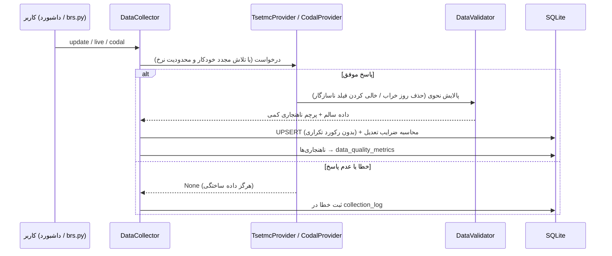

# پایپ‌لاین و چرخه داده‌های BRS (Data Pipeline)

## ۱. چرخه حیات داده

## ۲. کارهای گردآوری

| کار | دستور | منبع | توضیح |
| :--- | :--- | :--- | :--- |
| جامعه سهام | `brs.py universe` | دیده‌بان کامل TSETMC | فیلتر yVal ∈ {300, 303}، بدون تابلوی بلوکی |
| کندل امروز کل بازار | `brs.py update` | `GetMarketWatch` + `GetClosingPriceInfo` | یک درخواست، بعد از ساعت ۱۳؛ تاریخ از آخرین روز معاملاتی رسمی |
| تاریخچه روزانه | `brs.py update` | `GetClosingPriceDailyList` | بار اول کامل؛ بعد ۳۰ روز اخیر (افزایشی). TSETMC کندل امروز را تا عصر به‌تدریج منتشر می‌کند؛ رکورد دیده‌بان با داده رسمی بازنویسی می‌شود |
| حقیقی/حقوقی | `brs.py update` | `GetClientTypeHistory` | بار اول کامل؛ بعد روزهای جدید + حداکثر ۲۰ «حفره» در هر اجرا (سرویس کل تاریخچه گاهی روزهایی را جا می‌اندازد که سرویس روزبه‌روز دارد؛ روزهای قبل از اولین آمار نماد درخواست نمی‌شوند). TSETMC آمار هر نماد را جداگانه تا عصر منتشر می‌کند و عدد منتشرشده بعداً تغییر نمی‌کند؛ روزهای منتشرنشده در اجرای بعدی گرفته می‌شوند |
| کدال | `brs.py codal --judge` | جستجوی کدال | فقط نمادهای داخل دامنه + قضاوت Jev |
| پایش زنده | `brs.py live` | `GetMarketWatch` + `GetClientTypeAll` | ۲ درخواست برای کل بازار در هر چرخه ۳۰ ثانیه‌ای. فقط اسنپ‌شاتی ذخیره می‌شود که **هر** فیلدش (از جمله سطوح ۲ تا ۵ عمق بازار) تغییر کرده باشد. زمان سرور هر نماد از تاریخ و ساعت خود TSETMC (`dEven` + `hEven`) ساخته می‌شود؛ بدون تاریخ سرور، تازگی «نامعلوم» است و حدس زده نمی‌شود |

## ۳. سطوح اعتبارسنجی

### ۳.۱. نحوی
- قیمت‌های بیشترین/کمترین/پایانی مثبت، `High ≥ Low`، حجم غیرمنفی ← در غیر این صورت روز حذف می‌شود.
- قیمت اولین/آخرین معامله خارج از بازه روز ← فقط همان فیلد NULL می‌شود.
- اسنپ‌شات: زمان ثبت الزامی، آخرین قیمت در دامنه مجاز روز، قیمت صفر با وجود معامله ممنوع ← اسنپ‌شات رد و در `data_quality_metrics` ثبت می‌شود.

### ۳.۲. کمی (علامت‌گذاری بدون حذف)
- تغییر قیمت پایانی نسبت به قیمت مرجع بیش از ۱۰.۵٪ (معمولاً روز بازگشایی پس از توقف طولانی).
- حجم بیش از ۱۰ برابر میانه ۳۰ روز قبل.
