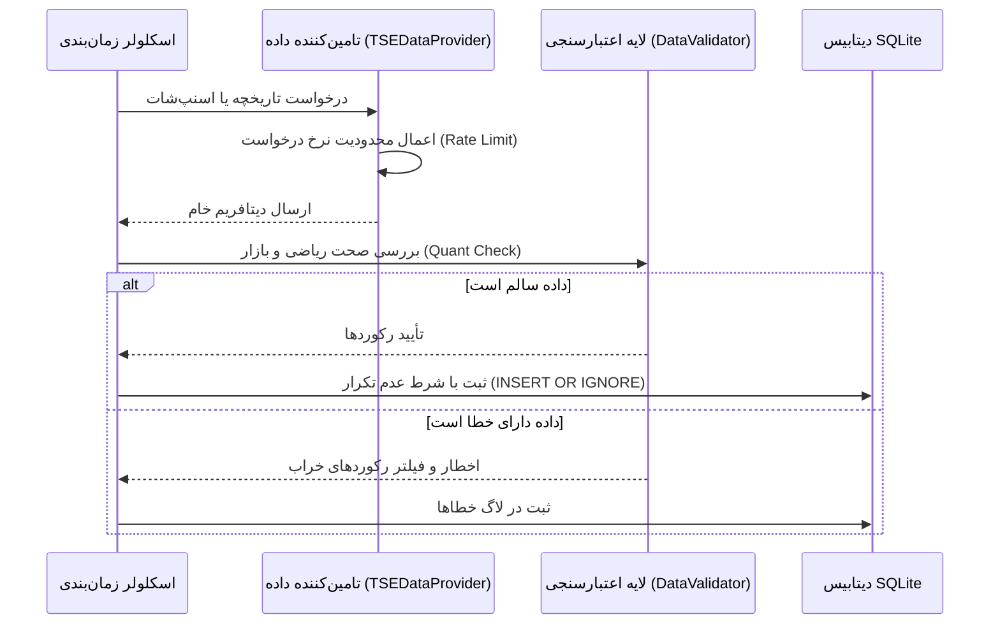

# پایپ‌لاین و چرخه داده‌های BRS (Data Pipeline)

## ۱. چرخه حیات داده

## ۲. سطوح اعتبارسنجی داده

### ۲.۱. اعتبارسنجی نحوی (Syntax Validation)
- قیمت‌ها مثبت و بزرگتر از صفر باشند.
- حجم و ارزش معاملات غیرمنفی باشند.
- رابطه ریاضی کندل حفظ شود: $High \ge Low$ و $High \ge Open, Close$ و $Low \le Open, Close$.

### ۲.۲. اعتبارسنجی کمی و مالی (Quant Anomaly Validation)
- جهش‌های قیمتی غیرعادی خارج از دامنه نوسان مجاز روزانه شناسایی و علامت‌گذاری شوند.
- حجم‌های انفجاری غیرطبیعی (بیش از ۱۰ برابر میانگین ۳۰ روزه) تفکیک شوند.
