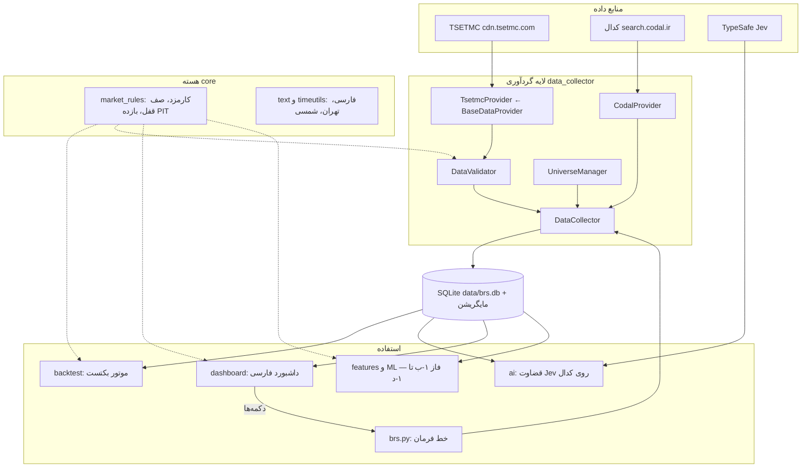

# طراحی فاز اول BRS — دستیار نوسان‌گیری سهام بورس و فرابورس

> به‌روزرسانی بازبینی ۲۰۲۶-۱۰-۱۱: قرارداد جدید، محدودیت‌ها و رفتار اصلاح‌شده در [foundation_review_fa.md](foundation_review_fa.md) ثبت شده است. مسیر نصب فعلی [windows_phase1_fa.md](windows_phase1_fa.md) است. ادعاهای اجرای قبلی این سند در این بازبینی مستقلاً تأیید نشده‌اند.

> نسخهٔ بازبینی پایه: 0.5.1 — نتیجهٔ آزمون‌ها و محدودیت‌ها در گزارش بازبینی ثبت می‌شوند.

## ۱. هدف و دامنه

**هدف نهایی:** ابزاری که با داده‌های رسمی بازار و هوش مصنوعی، فرصت‌های نوسان‌گیری سودآور را پیدا کند و
**هر ایده را با هزینه‌های مستند، دادهٔ خارج از نمونه و سپس معاملات آزمایشی ارزیابی کند**.
بکتست تضمین سود آینده نیست و برنامه فعلی هنوز استراتژی تأییدشده ندارد. دو افق زمانی:

| موتور | افق | داده اصلی |
| :--- | :--- | :--- |
| نوسان‌گیری درون‌روزی | همان روز (۹:۰۰ تا ۱۲:۳۰) | اسنپ‌شات ۳۰ ثانیه‌ای کل بازار: ۵ مظنه، صف‌ها، حقیقی/حقوقی |
| نوسان‌گیری کوتاه‌مدت | ۲ تا ۳ روز معاملاتی | قیمت روزانه، حقیقی/حقوقی روزانه، اطلاعیه‌های کدال |

**دامنه نمادها:** فقط سهام عادی **بورس** (کد نوع ابزار 300) و **فرابورس** (کد 303).
صندوق‌ها، اوراق، حق‌تقدم، اختیار معامله و تابلوهای بلوکی/عمده حذف می‌شوند. بازار پایه (309) و
بازار SME (313) خاموش هستند و از `config/default.yaml` قابل روشن شدن‌اند. تعداد نمادهای مشمول باید از گزارش هر همگام‌سازی خوانده شود؛
جامعهٔ امروز، جامعهٔ تاریخی همهٔ روزها را اثبات نمی‌کند.

**آنچه سیستم انجام نمی‌دهد:** سفارش نمی‌گذارد و به حساب کارگزاری وصل نمی‌شود. تصمیم و اجرای
معامله با خود شما در سامانه کارگزاری (فارابیکسو) است. خروجی‌ها توصیه سرمایه‌گذاری نیستند.

### هزینه و امکان انجام معامله

نرخ‌های `config/default.yaml` فرض فعلی پروژه‌اند: خرید ۰.۳۷۱۲٪ و فروش ۰.۸۸٪.
در این بازبینی، اعتبار جاری این نرخ‌ها از منبع رسمی مستقلاً تأیید نشده است.
با همین فرض‌ها، رشد سربه‌سر بدون لغزش از `(1 + buy) / (1 - sell) - 1` به دست می‌آید
(حدود ۱.۲۶۲۳٪). صف، نقدشوندگی و لغزش می‌توانند نتیجه را بدتر کنند؛ بازده نمودار معادل
بازده معاملهٔ قابل اجرا نیست. تقویم، دامنه و هزینه باید متناسب با تاریخ معامله مستند شوند.

---

## ۲. وضعیت فعلی: کد پایه داده و ویژگی‌های روزانه

| بخش | پیاده‌سازی فعلی | تأیید باقی‌مانده |
| :--- | :--- | :--- |
| TSETMC و جامعه سهام | اتصال مستقیم، شناسه ابزار، فیلتر نوع 300/303 | دسترسی از شبکه کاربر، تغییر پاسخ و پوشش واقعی |
| تاریخچه و حقیقی/حقوقی | قیمت خام، مرجع، منشأ و آرشیو اصلاحات از مایگریشن 007 | زمان دسترسی تاریخی و جامعه شامل نمادهای حذف‌شده |
| اسنپ‌شات | پنج مظنه، آمار، زمان دریافت و ثبت تغییرات | تاریخ کامل منبع، تأخیر، قطعی و پوشش نوبت‌ها |
| کدال و Jev | گردآوری و قضاوت ساخت‌یافته با نسخه سؤال | صحت استخراج، هزینه جاری و ارزش افزوده خارج از نمونه |
| اعتبارسنجی | رد داده نامعتبر، حفظ مقدار مجهول، گزارش شمارش | پایش خطاهای واقعی چند جلسه بازار |
| موتور بکتست روزانه | اجرای روز بعد با قیود، هزینه و حسابداری اصلاح‌شده | مدل صف، اقدامات شرکتی و اجرای درون‌روزی معتبر |
| دیتابیس و ویژگی | مایگریشن تراکنشی، پشتیبان، ورودی و خروجی تغییرناپذیر هر اجرا | تمرین بازیابی و آرشیو منظم روی رایانه کاربر |
| داشبورد و ابزار Windows | Streamlit، SETUP، CHECK_FEED و doctor | اجرای موفق روی رایانه کاربر |
| آزمون و CI | مجموعه آفلاین و ماتریس Windows/Linux | نتیجه هر commit در GitHub Actions مرجع است |

### باگ‌های نسخه 0.4.2 که در این فاز رفع شد
1. ستون `adj_close` در واقع قیمت پایانی رسمی خام بود (نه تعدیل‌شده) و `adjustment_factor` عددی بی‌معنا بود.
2. قیمت مرجع (دیروز) دور ریخته می‌شد ← تشخیص صف قفل در بکتست هرگز کار نمی‌کرد.
3. بکتست در روز صف خرید قفل، خرید را پر می‌کرد، آن هم بالاتر از سقف مجاز (۳۸۸۳.۸۸ به جای حداکثر ۳۸۸۰).
4. بکتست در همان روز سیگنال معامله می‌کرد (نگاه به آینده).
5. هیچ اسنپ‌شات زنده‌ای ذخیره نمی‌شد (فیلد `captured_at` ساخته نمی‌شد).
6. نمادها دو بار ثبت می‌شدند (یک بار با ISIN، یک بار با نام).
7. مایگریشن‌های SQL هرگز اجرا نمی‌شدند؛ ساعت سیستم به جای ساعت تهران استفاده می‌شد.

---

## ۳. معماری

---

## ۴. منابع داده

| منبع | داده | آدرس | تناوب | پروکسی |
| :--- | :--- | :--- | :--- | :--- |
| TSETMC دیده‌بان | همه سهام: قیمت، دامنه نوسان، ۵ مظنه | `/api/ClosingPrice/GetMarketWatch` | هر ۳۰ ثانیه در ساعات بازار | Direct |
| TSETMC حقیقی/حقوقی امروز | کل بازار | `/api/ClientType/GetClientTypeAll` | هر ۳۰ ثانیه | Direct |
| TSETMC تاریخچه روزانه | قیمت‌ها + قیمت مرجع | `/api/ClosingPrice/GetClosingPriceDailyList/{ins}/{n}` | روزانه، بعد از ساعت ۱۴ | Direct |
| TSETMC تاریخچه حقیقی/حقوقی | خرید/فروش حقیقی و حقوقی | `/api/ClientType/GetClientTypeHistory/{ins}[/{date}]` | روزانه | Direct |
| TSETMC ریزمعاملات | تیک‌به‌تیک امروز | `/api/Trade/GetTrade/{ins}` | پایان روز (فاز ۱-ه) | Direct |
| کدال | اطلاعیه‌ها | `search.codal.ir/api/search/v2/q` | چند بار در روز | Direct |
| TypeSafe | قضاوت هوش مصنوعی | `api.typesafe.ai/v1/systemone` | هنگام اطلاعیه جدید | VPN |

> مسیرهای شبکه در جدول، گزینهٔ بررسی‌اند، نه تضمین اتصال. تأخیر باید در محل اجرای کاربر
> اندازه‌گیری شود. در صورت استفاده از Proxifier، دسترسی Direct و مسیر فعلی را مقایسه کنید؛
> خطای شبکه به‌تنهایی علت را مشخص نمی‌کند.

---

## ۵. قوانین داده (Point-in-Time)

| ستون | معنی | مصرف در فیچر |
| :--- | :--- | :---: |
| `open_raw`، `high_raw`، `low_raw` | اولین، بیشترین و کمترین معامله روز | ✅ |
| `close_raw` | آخرین معامله | ✅ |
| `close_final_raw` | قیمت پایانی رسمی (مبنای دامنه نوسان فردا) | ✅ |
| `ref_price_raw` | قیمت مرجع روز (در روز اقدام شرکتی تعدیل‌شده توسط بورس) | ✅ |
| `adj_close` | قیمت تعدیل‌شده رو به عقب (فقط نمودار) | ❌ ممنوع |

- **بازده روزانه:** `close_final_raw / ref_price_raw - 1`. برای پیوستگی سری قیمت استفاده می‌شود؛ جایگزین حسابداری سود نقدی، حق‌تقدم یا تعداد سهام پرتفوی نیست. خام بودن داده، زمان دسترسی تاریخی آن را اثبات نمی‌کند.
- **تخمین صف قفل در مدل روزانه:** کل روز در یک قیمت (بیشترین = کمترین) و حداقل ۱.۵٪ دور از قیمت مرجع. این یک فرض پژوهشی است؛ صف واقعی و جایگاه سفارش از این شرط اثبات نمی‌شود.
- **اجرای سفارش در بکتست:** سیگنال در پایان روز t، اجرا در روز t+1 به میانگین موزون (ارزش ÷ حجم) + لغزش، محدود به [کمترین، بیشترین] همان روز.
- **همه زمان‌ها** با منطقه زمانی تهران ذخیره می‌شوند و **همه قیمت‌ها** به ریال. تومان فقط در نمایش استفاده می‌شود.

---

## ۶. نقشه راه فاز ۱

| مرحله | نام | خروجی | معیار پذیرش |
| :--- | :--- | :--- | :--- |
| ۱-الف | پایه داده | کد این نسخه + آرشیو پایلوت | نصب موفق؛ چند جلسه داده واقعی با پوشش و تأخیر اندازه‌گیری‌شده |
| ۱-ب | فیچرها (BRS-005) | بخش روزانه پیاده شده: ۳۴ فیچر قیمت، صف، پول هوشمند و بازار در انبار فیچر Parquet (`docs/features.md`) — بخش ۲: فیچرهای رویداد کدال | آزمون بریدن سری پاس شود؛ دسترس‌پذیری تاریخی، سوگیری بقا و پوشش داده جداگانه سنجیده شوند |
| ۱-ج | برچسب + بکتست پایه (BRS-004) | برچسب «بازده خالص ۲ و ۳ روزه بعد از کارمزد» + ۳ استراتژی قاعده‌محور ساده | مقایسه با خرید تصادفی؛ همه آزمایش‌ها در جدول `experiments` |
| ۱-د | مدل یادگیری ماشین (BRS-006) | LightGBM با اعتبارسنجی پیش‌رو (Walk-Forward) با فاصله امن (Purge/Embargo) | بهبود نسبت به پایه‌ها روی داده خارج از نمونه، پس از هزینه؛ تعداد معاملات، عدم‌قطعیت و پایداری بین دوره‌ها گزارش شوند. حدود پذیرش پیش از دیدن آزمون نهایی تعیین شوند |
| ۱-ه | موتور درون‌روزی | ۴ تا ۶ هفته اسنپ‌شات زنده + ریزمعاملات؛ فیچرهای صف و قدرت خریدار لحظه‌ای | بکتست درون‌روزی با فرض واقع‌بینانه جایگاه در صف |
| ۱-و | گزارش روزانه | فهرست رتبه‌بندی‌شده «نمادهای قابل بررسی برای فردا» در داشبورد، با احتمال و آمار بکتست هر سیگنال | هیچ سیگنالی بدون بکتست نمایش داده نمی‌شود (قانون ۲) |

### فیچرهای پیشنهادی فاز ۱-ب
- **قیمت:** بازده PIT ۱، ۳، ۵ و ۲۰ روزه؛ نوسان‌پذیری؛ فاصله از سقف و کف ۲۰ روزه؛ تعداد روزهای متوالی صف قفل
- **پول هوشمند:** ورود پول حقیقی (ارزش خرید منهای فروش حقیقی)؛ سرانه خرید و فروش؛ قدرت خریدار؛ تغییر مالکیت حقیقی به حقوقی
- **حجم:** نسبت حجم به میانگین ۲۰ روزه؛ نسبت ارزش معاملات به حجم مبنا
- **رویداد:** نوع و اثر اطلاعیه کدال از Jev در ۱ تا ۳ روز اخیر؛ نزدیکی به انتشار گزارش ماهانه
- **بازار:** نسبت نمادهای مثبت؛ تعداد صف‌های خرید و فروش؛ ورود پول حقیقی کل بازار

---

## ۷. نقش هوش مصنوعی

| ابزار | نقش | چرا |
| :--- | :--- | :--- |
| **Jev (TypeSafe)** | قضاوت معنایی روی متن کدال: نوع اطلاعیه، اثر احتمالی، اهمیت | خروجی احتمالاتی و نوع‌دار؛ مستقیم به فیچر عددی تبدیل می‌شود؛ هزینه و دسترسی جاری باید پیش از فعال‌سازی از سرویس بررسی شوند |
| **LightGBM** (فاز ۱-د) | پیش‌بینی احتمال بازده خالص مثبت ۲ تا ۳ روزه | یک گزینه برای داده جدولی؛ انتخاب نهایی پس از ساخت پایه و ارزیابی داده |
| **Claude Code** | توسعه کد، آزمون، مستندسازی | همکار برنامه‌نویسی؛ قوانین را از AGENTS.md و CLAUDE.md می‌خواند |

**اصل مهم:** خروجی Jev «سیگنال» نیست. قضاوت‌ها اول ذخیره می‌شوند و بعد بررسی می‌کنیم آیا با بازده
واقعی روزهای بعد رابطه دارند یا نه. با هر تغییر در متن سؤال‌ها، `QUESTIONS_VERSION` در
`ai/codal_judge.py` بالا می‌رود تا نتایج نسخه‌های مختلف با هم قاطی نشوند.

**گزارش ثبت‌شده در نسخه قبلی، مستقلاً در این بازبینی تأیید نشده:** اجرای ۲۳ اطلاعیه در ۱۹ مهر ۱۴۰۵؛ تشخیص نوع اطلاعیه دقیق است (اطمینان اغلب بالای
۰.۹). اما امتیاز «اثر احتمالی» تقریباً همیشه حدود «خنثی» است، چون از عنوان به‌تنهایی معلوم نیست خبر خوب
است یا بد. **گام بعدی (فاز ۱-ب):** دادن متن اصلی گزارش به Jev، مثلاً رشد فروش ماهانه نسبت به ماه قبل و
سال قبل در گزارش‌های «ن-۳۰»، یا مبلغ سود تقسیمی در مقایسه با پیش‌بینی. اعداد را کد استخراج و مقایسه
می‌کند و Jev فقط قضاوت معنایی را انجام می‌دهد.

---

## ۸. ابزارهای Vibe Coding و روش کار

راهنمای کامل و فرمان‌های PowerShell در [windows_phase1_fa.md](windows_phase1_fa.md) است.
Git و uv برای نصب، VS Code برای ویرایش، و یک دستیار برنامه‌نویسی کافی‌اند. SETUP، Python 3.11،
نسخه‌های قفل‌شده کتابخانه‌ها، pytest و Ruff را آماده می‌کند. برای پایه داده، Docker، WSL، GPU
یا خرید سرویس هوش مصنوعی جدید لازم نیست. نصب بودن ابزار روی رایانه کاربر باید با خروجی واقعی تأیید شود.

1. هدف هر تغییر را به فارسی و محدود بنویسید؛ دستیار باید AGENTS.md و گزارش بازبینی را بخواند.
2. تغییر روی شاخه feature، همراه آزمون مرتبط و مستندات انجام شود.
3. همه آزمون‌های آفلاین و Ruff پاس شوند؛ اثر تغییر در داشبورد بررسی شود.
4. پیش از ادغام، نتیجه CI و تغییرات PR بازبینی شود؛ ادعای دقت مدل جای ارزیابی زمانی را نمی‌گیرد.

## ۹. ترتیب پژوهش بعدی

1. نصب Windows، گزارش `doctor-feed.json` و دریافت پنج نماد پایلوت.
2. ضبط چند جلسه واقعی و اندازه‌گیری پوشش، قطعی، تأخیر و رشد فایل‌ها؛ هدف پیشنهادی پایلوت در گزارش بازبینی است.
3. تکمیل زمان دسترسی داده، جامعه تاریخی و تقویم؛ تعریف دقیق خروج در جلسه دوم و سوم و رفتار توقف/صف.
4. ساخت برچسب بازده خالص، استراتژی‌های ساده و benchmark با هزینه یکسان؛ ثبت همه اجراها و ورودی‌ها.
5. ارزیابی پیش‌رو با حذف هم‌پوشانی برچسب‌ها و فاصله زمانی مناسب؛ سپس مقایسه مدل ML با پایه‌ها.
6. آزمایش بدون پول واقعی؛ توسعه موتور درون‌روزی به آرشیو معامله/مظنه و مدل اجرای جدا نیاز دارد.

## ۱۰. ریسک‌های تعیین‌کننده

- پاسخ‌های API ممکن است تغییر یا اصلاح شوند. داده ناقص باید خطا/مقدار مجهول بماند؛ تست آفلاین دسترسی بازار را تضمین نمی‌کند.
- جامعه امروز نمادهای حذف‌شده را کامل پوشش نمی‌دهد؛ اندازه و جهت اثر سوگیری بقا هنوز سنجیده نشده است.
- حجم فایل و زمان دریافت کل بازار باید روی شبکه و رایانه کاربر اندازه‌گیری شود؛ عدد ثابت ظرفیت وعده داده نمی‌شود.
- تنظیمات فعلی، آرشیو مقررات تاریخی نیستند؛ کارمزد، دامنه و تقویم نیاز به ثبت نسخه‌دار دارند.
- مدل روزانه VWAP امکان پرشدن سفارش و صف را اثبات نمی‌کند؛ عبور پوزیشن باز از اقدام شرکتی فعلاً متوقف می‌شود.
- هیچ نتیجه این مرحله اثبات سودآوری آینده نیست. جزئیات محدودیت‌ها و شواهد اجرا در [foundation_review_fa.md](foundation_review_fa.md) نگهداری می‌شوند.
