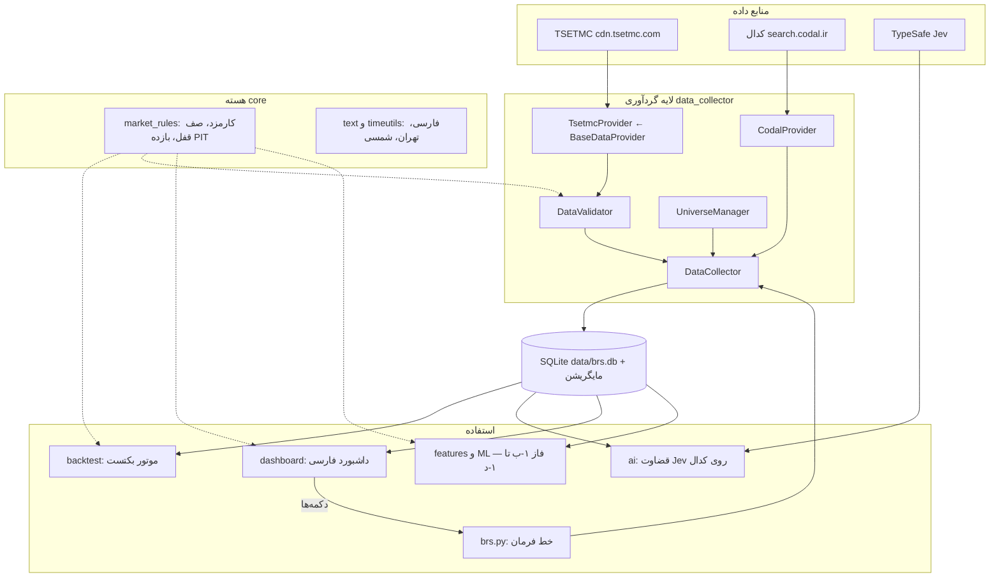

# طراحی فاز اول BRS — دستیار نوسان‌گیری سهام بورس و فرابورس

> به‌روزرسانی بازبینی ۲۰۲۶-۱۰-۱۱: قرارداد جدید، محدودیت‌ها و رفتار اصلاح‌شده در [foundation_review_fa.md](foundation_review_fa.md) ثبت شده است. مسیر نصب فعلی [windows_phase1_fa.md](windows_phase1_fa.md) است. ادعاهای اجرای قبلی این سند در این بازبینی مستقلاً تأیید نشده‌اند.

> آخرین به‌روزرسانی: ۱۹ مهر ۱۴۰۵ (2026-10-11) — نسخه 0.5.0

## ۱. هدف و دامنه

**هدف نهایی:** ابزاری که با داده‌های رسمی بازار و هوش مصنوعی، فرصت‌های نوسان‌گیری سودآور را پیدا کند و
**قبل از هر استفاده، سودآوری آن را روی گذشته با کسر کارمزد واقعی ثابت کند**. دو افق زمانی:

| موتور | افق | داده اصلی |
| :--- | :--- | :--- |
| نوسان‌گیری درون‌روزی | همان روز (۹:۰۰ تا ۱۲:۳۰) | اسنپ‌شات ۳۰ ثانیه‌ای کل بازار: ۵ مظنه، صف‌ها، حقیقی/حقوقی |
| نوسان‌گیری کوتاه‌مدت | ۲ تا ۳ روز معاملاتی | قیمت روزانه، حقیقی/حقوقی روزانه، اطلاعیه‌های کدال |

**دامنه نمادها:** فقط سهام عادی **بورس** (کد نوع ابزار 300) و **فرابورس** (کد 303).
صندوق‌ها، اوراق، حق‌تقدم، اختیار معامله و تابلوهای بلوکی/عمده حذف می‌شوند. بازار پایه (309) و
بازار SME (313) خاموش هستند و از `config/default.yaml` قابل روشن شدن‌اند. همگام‌سازی امروز:
**۵۹۴ نماد** (۳۵۵ بورس، ۲۳۹ فرابورس).

**آنچه سیستم انجام نمی‌دهد:** سفارش نمی‌گذارد و به حساب کارگزاری وصل نمی‌شود. تصمیم و اجرای
معامله با خود شما در سامانه کارگزاری (فارابیکسو) است. خروجی‌ها توصیه سرمایه‌گذاری نیستند.

### واقعیت اقتصادی که همه طراحی بر آن بنا شده

| کارمزد خرید | کارمزد فروش | حداقل رشد لازم برای سر به سر شدن |
| :---: | :---: | :---: |
| ۰.۳۷۱۲٪ | ۰.۸۸٪ | **۱.۲۶٪** |

یعنی هر استراتژی که میانگین سود ناخالصش در هر معامله کمتر از ۱.۲۶٪ باشد، در عمل زیان‌ده است.
برای نوسان‌گیری درون‌روزی این مانع بسیار بلند است؛ پس موتور درون‌روزی باید روی فرصت‌های با حرکت
بزرگ (شکست/تشکیل صف، ورود پول درشت) تمرکز کند، نه نوسان‌های کوچک.

---

## ۲. وضعیت فعلی: فاز ۱-الف (پایه داده) ✅

| بخش | وضعیت | توضیح |
| :--- | :---: | :--- |
| منبع داده مستقیم TSETMC | ✅ | `data_collector/tsetmc.py` — نگاشت صریح فیلدها، شناسه پایدار `ins_code` |
| جامعه سهام بورس و فرابورس | ✅ | فیلتر رسمی بر اساس yVal؛ ۵۹۴ نماد |
| تاریخچه روزانه Point-in-Time | ✅ | قیمت پایانی رسمی + قیمت مرجع؛ به‌روزرسانی افزایشی |
| حقیقی/حقوقی روزانه | ✅ | کل تاریخچه + به‌روزرسانی روزانه سبک |
| اسنپ‌شات زنده کل بازار | ✅ | یک درخواست برای همه سهام؛ ۵ مظنه با تعداد سفارش؛ حذف اسنپ‌شات بدون تغییر |
| اطلاعیه‌های کدال | ✅ | زمان انتشار به وقت تهران |
| هوش مصنوعی Jev روی کدال | ✅ | نوع، اثر احتمالی و اهمیت هر اطلاعیه (آزمون فارسی: ۵ از ۵ درست) |
| اعتبارسنجی و ناهنجاری | ✅ | رد داده خراب، علامت‌گذاری جهش قیمت و حجم انفجاری |
| موتور بکتست واقع‌گرا | ✅ | اجرای روز بعد، میانگین موزون، صف قفل، بازه قیمت روز، Mark-to-Market |
| مایگریشن + پشتیبان خودکار | ✅ | `database/migrations` + `data/backups` |
| داشبورد فارسی ساده | ✅ | دکمه‌ای؛ تاریخ شمسی؛ راست‌چین |
| عیب‌یاب (Doctor) | ✅ | اینترنت، پروکسی، دیتابیس، کلید هوش مصنوعی — با راه‌حل فارسی |
| آزمون خودکار + CI | ✅ | ۸۰ آزمون آفلاین (شامل همه صفحه‌های داشبورد) + ۴ آزمون شبکه؛ GitHub Actions روی پایتون 3.11 |

### باگ‌های نسخه 0.4.2 که در این فاز رفع شد
1. ستون `adj_close` در واقع قیمت پایانی رسمی خام بود (نه تعدیل‌شده) و `adjustment_factor` عددی بی‌معنا بود.
2. قیمت مرجع (دیروز) دور ریخته می‌شد ← تشخیص صف قفل در بکتست هرگز کار نمی‌کرد.
3. بکتست در روز صف خرید قفل، خرید را پر می‌کرد، آن هم بالاتر از سقف مجاز (۳۸۸۳.۸۸ به جای حداکثر ۳۸۸۰).
4. بکتست در همان روز سیگنال معامله می‌کرد (نگاه به آینده).
5. هیچ اسنپ‌شات زنده‌ای ذخیره نمی‌شد (فیلد `captured_at` ساخته نمی‌شد).
6. نمادها دو بار ثبت می‌شدند (یک بار با ISIN، یک بار با نام).
7. مایگریشن‌های SQL هرگز اجرا نمی‌شدند؛ ساعت سیستم به جای ساعت تهران استفاده می‌شد.

---

## ۳. معماری

---

## ۴. منابع داده

| منبع | داده | آدرس | تناوب | پروکسی |
| :--- | :--- | :--- | :--- | :--- |
| TSETMC دیده‌بان | همه سهام: قیمت، دامنه نوسان، ۵ مظنه | `/api/ClosingPrice/GetMarketWatch` | هر ۳۰ ثانیه در ساعات بازار | Direct |
| TSETMC حقیقی/حقوقی امروز | کل بازار | `/api/ClientType/GetClientTypeAll` | هر ۳۰ ثانیه | Direct |
| TSETMC تاریخچه روزانه | قیمت‌ها + قیمت مرجع | `/api/ClosingPrice/GetClosingPriceDailyList/{ins}/{n}` | روزانه، بعد از ساعت ۱۴ | Direct |
| TSETMC تاریخچه حقیقی/حقوقی | خرید/فروش حقیقی و حقوقی | `/api/ClientType/GetClientTypeHistory/{ins}[/{date}]` | روزانه | Direct |
| TSETMC ریزمعاملات | تیک‌به‌تیک امروز | `/api/Trade/GetTrade/{ins}` | پایان روز (فاز ۱-ه) | Direct |
| کدال | اطلاعیه‌ها | `search.codal.ir/api/search/v2/q` | چند بار در روز | Direct |
| TypeSafe | قضاوت هوش مصنوعی | `api.typesafe.ai/v1/systemone` | هنگام اطلاعیه جدید | VPN |

> تاخیر عادی TSETMC حدود ۱.۵ ثانیه است. اگر عیب‌یاب کندی همیشگی گزارش کرد، `*.tsetmc.com` و
> `*.codal.ir` را در Proxifier روی Direct بگذارید.

---

## ۵. قوانین داده (Point-in-Time)

| ستون | معنی | مصرف در فیچر |
| :--- | :--- | :---: |
| `open_raw`، `high_raw`، `low_raw` | اولین، بیشترین و کمترین معامله روز | ✅ |
| `close_raw` | آخرین معامله | ✅ |
| `close_final_raw` | قیمت پایانی رسمی (مبنای دامنه نوسان فردا) | ✅ |
| `ref_price_raw` | قیمت مرجع روز (در روز اقدام شرکتی تعدیل‌شده توسط بورس) | ✅ |
| `adj_close` | قیمت تعدیل‌شده رو به عقب (فقط نمودار) | ❌ ممنوع |

- **بازده روزانه:** `close_final_raw / ref_price_raw - 1`. فقط از داده همان روز استفاده می‌کند و اثر افزایش سرمایه و سود نقدی را حذف می‌کند.
- **صف قفل:** کل روز در یک قیمت (بیشترین = کمترین) و حداقل ۱.۵٪ دور از قیمت مرجع. به عدد دامنه نوسان (±۳٪ یا ±۵٪) وابسته نیست.
- **اجرای سفارش در بکتست:** سیگنال در پایان روز t، اجرا در روز t+1 به میانگین موزون (ارزش ÷ حجم) + لغزش، محدود به [کمترین، بیشترین] همان روز.
- **همه زمان‌ها** با منطقه زمانی تهران ذخیره می‌شوند و **همه قیمت‌ها** به ریال. تومان فقط در نمایش استفاده می‌شود.

---

## ۶. نقشه راه فاز ۱

| مرحله | نام | خروجی | معیار پذیرش |
| :--- | :--- | :--- | :--- |
| ۱-الف | پایه داده | (این نسخه) | ✅ انجام شد |
| ۱-ب | فیچرها (BRS-005) | ✅ بخش ۱: ۳۴ فیچر قیمت، صف، پول هوشمند و بازار در انبار فیچر Parquet (`docs/features.md`) — بخش ۲: فیچرهای رویداد کدال | ✅ آزمون خودکار «بریدن داده» (بدون نگاه به آینده) و آزمون بی‌اثری افزایش سرمایه |
| ۱-ج | برچسب + بکتست پایه (BRS-004) | برچسب «بازده خالص ۲ و ۳ روزه بعد از کارمزد» + ۳ استراتژی قاعده‌محور ساده | مقایسه با خرید تصادفی؛ همه آزمایش‌ها در جدول `experiments` |
| ۱-د | مدل یادگیری ماشین (BRS-006) | LightGBM با اعتبارسنجی پیش‌رو (Walk-Forward) با فاصله امن (Purge/Embargo) | Profit Factor ≥ ۱.۳۵، افت سرمایه ≤ ۱۵٪، شارپ ≥ ۱.۲ روی داده **خارج از نمونه** |
| ۱-ه | موتور درون‌روزی | ۴ تا ۶ هفته اسنپ‌شات زنده + ریزمعاملات؛ فیچرهای صف و قدرت خریدار لحظه‌ای | بکتست درون‌روزی با فرض واقع‌بینانه جایگاه در صف |
| ۱-و | گزارش روزانه | فهرست رتبه‌بندی‌شده «نمادهای قابل بررسی برای فردا» در داشبورد، با احتمال و آمار بکتست هر سیگنال | هیچ سیگنالی بدون بکتست نمایش داده نمی‌شود (قانون ۲) |

### فیچرهای پیشنهادی فاز ۱-ب
- **قیمت:** بازده PIT ۱، ۳، ۵ و ۲۰ روزه؛ نوسان‌پذیری؛ فاصله از سقف و کف ۲۰ روزه؛ تعداد روزهای متوالی صف قفل
- **پول هوشمند:** ورود پول حقیقی (ارزش خرید منهای فروش حقیقی)؛ سرانه خرید و فروش؛ قدرت خریدار؛ تغییر مالکیت حقیقی به حقوقی
- **حجم:** نسبت حجم به میانگین ۲۰ روزه؛ نسبت ارزش معاملات به حجم مبنا
- **رویداد:** نوع و اثر اطلاعیه کدال از Jev در ۱ تا ۳ روز اخیر؛ نزدیکی به انتشار گزارش ماهانه
- **بازار:** نسبت نمادهای مثبت؛ تعداد صف‌های خرید و فروش؛ ورود پول حقیقی کل بازار

---

## ۷. نقش هوش مصنوعی

| ابزار | نقش | چرا |
| :--- | :--- | :--- |
| **Jev (TypeSafe)** | قضاوت معنایی روی متن کدال: نوع اطلاعیه، اثر احتمالی، اهمیت | خروجی احتمالاتی و نوع‌دار؛ مستقیم به فیچر عددی تبدیل می‌شود؛ هزینه حدود ۰.۰۰۰۰۳ دلار برای هر اطلاعیه |
| **LightGBM** (فاز ۱-د) | پیش‌بینی احتمال بازده خالص مثبت ۲ تا ۳ روزه | استاندارد صنعت برای داده جدولی؛ سریع؛ تفسیرپذیر |
| **Claude Code** | توسعه کد، آزمون، مستندسازی | همکار برنامه‌نویسی؛ قوانین را از AGENTS.md و CLAUDE.md می‌خواند |

**اصل مهم:** خروجی Jev «سیگنال» نیست. قضاوت‌ها اول ذخیره می‌شوند و بعد بررسی می‌کنیم آیا با بازده
واقعی روزهای بعد رابطه دارند یا نه. با هر تغییر در متن سؤال‌ها، `QUESTIONS_VERSION` در
`ai/codal_judge.py` بالا می‌رود تا نتایج نسخه‌های مختلف با هم قاطی نشوند.

**نتیجه اولین اجرا روی ۲۳ اطلاعیه واقعی (۱۹ مهر ۱۴۰۵):** تشخیص نوع اطلاعیه دقیق است (اطمینان اغلب بالای
۰.۹). اما امتیاز «اثر احتمالی» تقریباً همیشه حدود «خنثی» است، چون از عنوان به‌تنهایی معلوم نیست خبر خوب
است یا بد. **گام بعدی (فاز ۱-ب):** دادن متن اصلی گزارش به Jev، مثلاً رشد فروش ماهانه نسبت به ماه قبل و
سال قبل در گزارش‌های «ن-۳۰»، یا مبلغ سود تقسیمی در مقایسه با پیش‌بینی. اعداد را کد استخراج و مقایسه
می‌کند و Jev فقط قضاوت معنایی را انجام می‌دهد.

---

## ۸. ابزارهای Vibe Coding و روش کار

| ابزار | کاربرد | وضعیت |
| :--- | :--- | :---: |
| Claude Code (اپ دسکتاپ) | همکار اصلی برنامه‌نویسی | ✅ |
| `CLAUDE.md` و `AGENTS.md` | قوانین ثابت پروژه برای همه هوش‌های مصنوعی | ✅ |
| پلاگین TypeSafe (`typesafe@typesafe-ai`) | راهنمای ساخت با Jev برای Claude | ✅ نصب شد |
| Git + GitHub + Actions | تاریخچه، پشتیبان، آزمون خودکار | ✅ |
| Python 3.11 + uv + `requirements.lock.txt` | محیط تکرارپذیر و نصب سریع | ✅ |
| pytest + ruff | آزمون و بررسی کیفیت کد | ✅ |
| Streamlit | داشبورد | ✅ |
| `.claude/launch.json` | Claude داشبورد را خودش اجرا و بررسی می‌کند | ✅ |
| DB Browser for SQLite (اختیاری) | دیدن مستقیم جدول‌های دیتابیس | — |

### چرخه کار پیشنهادی
1. در Claude Code به فارسی بنویسید چه می‌خواهید (مثلاً «فیچرهای پول هوشمند را اضافه کن»).
2. Claude یک شاخه `feature/...` می‌سازد، کد را می‌نویسد، آزمون اضافه می‌کند و همه آزمون‌ها را اجرا می‌کند.
3. نتیجه را در داشبورد ببینید (START.bat).
4. اگر راضی بودید، بگویید «commit و push کن». CI در GitHub دوباره همه آزمون‌ها را اجرا می‌کند.

### قواعد طلایی Vibe Coding برای این پروژه
- هر جلسه فقط **یک** قابلیت. کار بزرگ را به مراحل کوچک بشکنید.
- همیشه بخواهید «با آزمون» و برای منطق معاملاتی «با بکتست خارج از نمونه».
- به ادعای «دقت ۹۰٪ به بالا» در پیش‌بینی قیمت شک کنید. تقریباً همیشه نشانه نشت داده است.
- کلیدها فقط در `.env` نگهداری می‌شوند. **مخزن GitHub عمومی است.**

### تنظیمات Proxifier
| دامنه | مسیر |
| :--- | :--- |
| `*.tsetmc.com`، `*.codal.ir`، `*.irfarabi.com` | **Direct** (سایت ایرانی) |
| `api.typesafe.ai`، `github.com`، `pypi.org`، `fonts.googleapis.com` | **VPN** |

---

## ۹. درس‌هایی از پروژه‌ها و پژوهش‌های مشابه

| منبع | درس |
| :--- | :--- |
| pytse-client | کتابخانه خوبی است، ولی نام‌گذاری ستون‌هایش گمراه‌کننده است و نسخه وابستگی‌اش قفل است؛ اتصال مستقیم به API امن‌تر است |
| finpy-tse، algotik-tse | گزینه‌های جایگزین برای منبع داده پشتیبان (پیاده‌سازی `BaseDataProvider`). لایسنس algotik GPL است |
| مقاله‌های داخلی ML روی بورس تهران | گزارش دقت ۹۷٪ در پیش‌بینی قیمت معمولاً نتیجه نشت داده یا ارزیابی اشتباه است؛ معیار ما بازده خالص خارج از نمونه است |
| López de Prado (Advances in Financial ML) | برچسب‌گذاری سه‌مانعی (Triple Barrier) با مانع‌های آگاه از کارمزد؛ اعتبارسنجی با Purge و Embargo؛ Meta-labeling |
| Microsoft Qlib | جدا نگه داشتن مراحل فیچر، برچسب، مدل و بکتست؛ آموزش دوباره دوره‌ای (Rolling) |

---

## ۱۰. ریسک‌ها و محدودیت‌های شناخته‌شده

1. **API غیررسمی TSETMC ممکن است تغییر کند.** راه‌حل: لایه `BaseDataProvider`، آزمون‌های شبکه (`pytest -m network`) و عیب‌یاب. شکل پاسخ هم در طول روز تغییر می‌کند (مثلاً عصرها کد نوع ابزار در دیده‌بان نیست و کندل امروز در سرویس تاریخچه تا عصر کامل نمی‌شود). برای هر دو حالت مسیر پشتیبان وجود دارد و پاسخ ناقص هرگز جایگزین داده کامل نمی‌شود.
2. **سوگیری بقا (Survivorship Bias):** دیده‌بان بازار فقط نمادهای فعلی را دارد و سهم‌های حذف‌شده از بورس در جامعه نیستند. نتیجه بکتست کمی خوش‌بینانه می‌شود. نمادها هرگز از دیتابیس حذف نمی‌شوند؛ تکمیل نمادهای حذف‌شده در فاز ۱-ج انجام می‌شود.
3. **رشد حجم دیتابیس:** پایش زنده کل بازار حدود ۵۰ تا ۱۰۰ مگابایت در روز است (اسنپ‌شات‌های بدون تغییر ذخیره نمی‌شوند). اگر لازم شد، داده قدیمی به Parquet منتقل می‌شود.
4. **تغییر مقررات** (دامنه نوسان، ساعات بازار، کارمزد): همه در `config/default.yaml` هستند و تشخیص صف قفل به عدد دامنه وابسته نیست.
5. **بیش‌برازش (Overfitting):** فقط معیارهای خارج از نمونه پذیرفته می‌شوند (`docs/quant_research_methodology.md`).
6. **روزهای توقف نماد** کندل ندارند. ضریب تعدیل و بازده روز بازگشایی از قیمت مرجع رسمی محاسبه می‌شوند و روز بازگشایی بدون دامنه نوسان، به‌عنوان ناهنجاری علامت می‌خورد.
